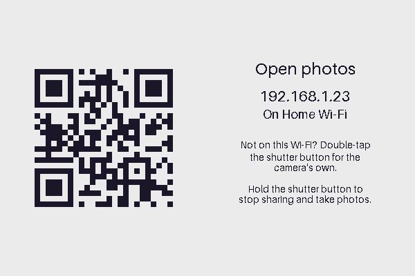
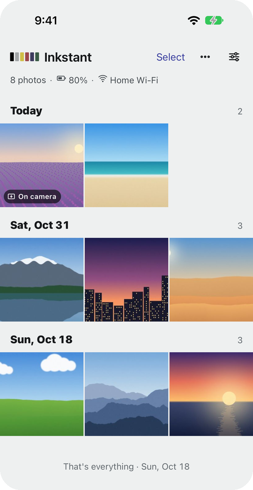
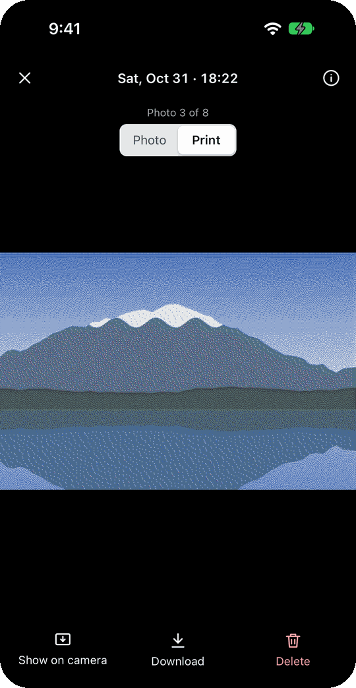
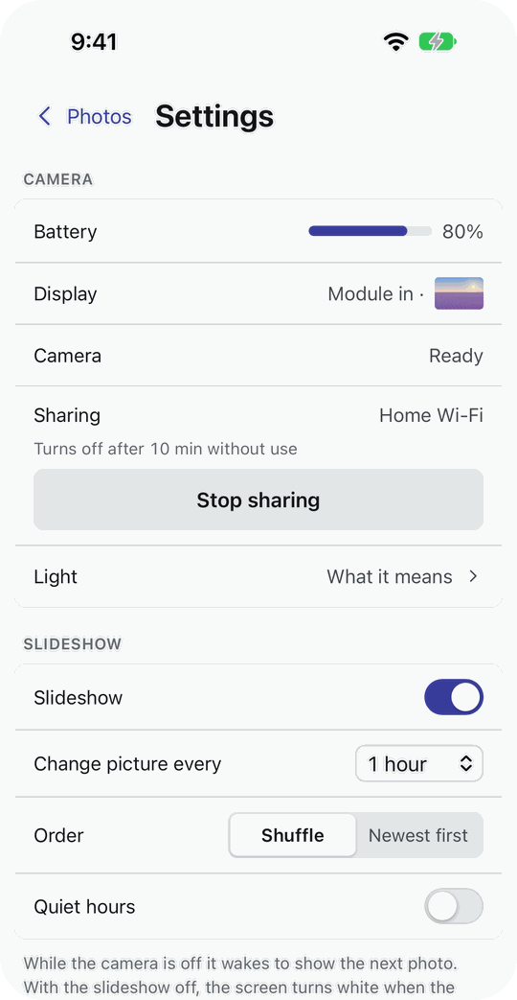

# Inkstant: The Instant Camera That Never Runs Out of Film

<!-- Hero photo of the finished camera goes here. -->

### Inkstant is a Raspberry Pi instant camera. Every photo "develops" on a small colour e-paper print that pops off the back for you to keep, and every photo is also saved at full size for your phone. No app, no account and no internet needed.

> **Building one?** The 3D-printable case and a step-by-step PDF guide to the whole build are in the **[Inkstant Build Pack](https://syntropylabs.io/products/inkstant-camera-build-pack)**. The software, and everything on this page, is free.

**[How it works](#how-it-works) · [What you need](#what-you-need) · [Build it](#build-it) · [Install the software](#install-the-software) · [Using Inkstant](#using-inkstant) · [Troubleshooting](#troubleshooting) · [For developers](#for-developers)**

---

## How it works

- **Shoot:** tap the shutter button. The photo develops on the print in about 20 seconds.
- **Keep:** pull the print off. E-paper keeps its picture with no power, so it's yours to keep. Put a fresh print on and keep shooting.
- **Share:** hold the shutter button and the print shows a QR code. Scan it, and every photo opens in your phone's browser.
- **Slideshow:** while the camera is off, it wakes up every hour to show a different photo on the print.

It goes together with **no soldering and no wiring**: the boards plug into each other, and the camera plugs in with a ribbon cable.

---

## What you need

<!-- Photo of all the parts laid out goes here. -->

| Part | What to get | Notes |
|---|---|---|
| **Raspberry Pi** | [Raspberry Pi 3B+](https://www.raspberrypi.com/products/raspberry-pi-3-model-b-plus/) | Or a 3A+, 4B or Zero 2 W ([compare them](#which-raspberry-pi)) |
| **Camera** | [Arducam 12MP IMX708 autofocus](https://www.amazon.com/dp/B0C9PYCV9S) | The 75° lens |
| **Camera cable** | 15-pin to 15-pin, 150 mm | The camera's box may only have a 15-to-22-pin one, which fits only a Zero 2 W ([Raspberry Pi's](https://www.raspberrypi.com/products/camera-cable/)) |
| **Battery** | [PiSugar 3 Plus](https://docs.pisugar.com/docs/product-wiki/battery/pisugar3/pisugar-3-series) | 5000 mAh. Its two buttons are the shutter and the power button |
| **Prints** | [Waveshare 3.6" e-Paper HAT+ (E)](https://www.amazon.com/dp/B0G656R3M9) | One per print. Get the **HAT+ (E)**, not the bare screen |
| **microSD card** | 32 GB or larger, A1-rated | Holds thousands of photos |
| **Case** | 3D-printed, from the [Inkstant Build Pack](https://syntropylabs.io/products/inkstant-camera-build-pack) | STL and STEP files, with a PDF guide to printing and assembling it |
| **Magnets** (optional) | Small disc magnets | Put a print you keep on the fridge |

You'll also need a small screwdriver, a USB-C charger, and a computer on the same Wi-Fi as the camera.

### Which Raspberry Pi?

The **3B+** is the easiest to buy, and it's the board Inkstant is built on. The 3A+, 4B and Zero 2 W work too: all four run the same software, use the PiSugar 3 Plus and fit the same case.

<details>
<summary><b>Compare the boards</b></summary>

<br>

| Board | Camera cable | Good to know |
|---|---|---|
| **Pi 3B+** | 15-to-15 pin | The camera switches off its unused USB ports and Ethernet to save battery |
| **Pi 3A+** | 15-to-15 pin | The smallest, and the lightest on the battery, but often sold out |
| **Pi 4B** | 15-to-15 pin | Focuses fastest, and uses the most battery |
| **Pi Zero 2 W** | 15-to-22 pin | Buy the version **with headers**. It joins 2.4 GHz Wi-Fi only, and its green light doesn't show through the case. It's held by two of the PiSugar's screws plus two printed spacers |

The Pi 3B and Pi 5 also run the software. [HARDWARE.md](HARDWARE.md#other-boards) has the measurements for every board.

</details>

---

## Build it

This page covers connecting the electronics and installing the software. For printing and assembling the case, with photos of every step, see the guide in the [Inkstant Build Pack](https://syntropylabs.io/products/inkstant-camera-build-pack).

Work with everything switched off. Touch something metal, like a radiator or a tap, before you handle the camera board, since static can damage it.

> [!WARNING]
> A print must always go on **straight, with each of the Pi's 40 pins in its own hole**. A print that's one pin or one row out connects 5 V to the wrong pins and can damage the Pi.

### 1. Charge the PiSugar

Charge it over USB-C, then make sure it's off: if its four little lights are on, hold **PWR** until they go out.

### 2. Mount the Pi on the PiSugar

Peel the film off the PiSugar's screw posts. Set the Pi on top, with the PiSugar's spring pins under the Pi's 40-pin header, and fit all four screws. They matter: the case holds the PiSugar, and the Pi rides on its screws.

**Zero 2 W:** only the two posts beside the header line up. Stand the case's two printed spacers under the Zero's other holes, then fit the two screws.

### 3. Connect the camera

Gently lift the flap on the Pi's camera connector. On a 3B+, 3A+ or 4B it's labelled **CAMERA**; on a Zero 2 W it's on the short edge. Push the cable in straight, with its **metal contacts facing away from the flap**, and press the flap down. Do the same at the camera board.

### 4. Put a print on

Line the print's socket up over the Pi's header, so no pin is left over at either end, and press straight down. To take it off, pull straight up without rocking it.

### 5. Close the case

The case's STL and STEP files are in the [Inkstant Build Pack](https://syntropylabs.io/products/inkstant-camera-build-pack), with a PDF guide to printing it and putting it together. To design your own case instead, [HARDWARE.md](HARDWARE.md#what-the-case-has-to-do) lists what the case has to do, with every part's measurements.

---

## Install the software

This takes about half an hour, mostly waiting.

### 1. Prepare the SD card

Install [Raspberry Pi Imager](https://www.raspberrypi.com/software/) on your computer, put the microSD card in, and choose:

| Imager setting | Choose |
|---|---|
| Device | Your Pi. **Raspberry Pi 3** covers the 3B+ and 3A+ |
| Operating system | Raspberry Pi OS (other) → **Raspberry Pi OS Lite (64-bit)** |
| Hostname | `inkstant` |
| Username and password | Anything you'll remember |
| Wi-Fi | Your home Wi-Fi and your country |
| SSH | On, with password login |

Then write the card.

### 2. Turn the camera on and connect

Put the card in the Pi. Press **PWR** briefly, then press and hold it until the PiSugar's lights count up. Wait about two minutes while the Pi sets itself up.

On your computer, open **Terminal** (Mac or Linux) or **PowerShell** (Windows), and connect with your username:

```bash
ssh your-username@inkstant.local
```

Type `yes` the first time it asks, then your password. Nothing shows while you type it; that's normal.

### 3. Run the setup command

```bash
curl -fsSL https://raw.githubusercontent.com/EnriqueNeyra/inkstant-camera/main/setup.sh | sudo bash -s -- --dev
```

It asks a few questions (press Enter to accept each suggestion), then installs everything in about 15 to 25 minutes. At the end, **write down the camera's Wi-Fi name and password**: you'll need them to see your photos away from home. It restarts when you press Enter.

If anything goes wrong, it stops and says what to fix. Running the same command again is always safe.

<details>
<summary><b>The questions, and what <code>--dev</code> does</b></summary>

<br>

| Question | What to answer |
|---|---|
| Camera Wi-Fi name | The network the camera makes when you're away from home. Enter keeps `Inkstant-XXXX` |
| Camera Wi-Fi password | Enter keeps the random one it suggests |
| Use "(your Wi-Fi)" for sharing at home? | Yes |
| Wi-Fi country | Only asked if it isn't set: two letters, like `US` or `GB` |
| Is the camera mounted upside down? | No, unless your case holds it that way |
| Is the display module mounted upside down? | Yes, in the Inkstant case. Answer No only if your own case holds it the other way |
| Developer mode? | Only asked without `--dev` |

`--dev` turns on **developer mode**: the camera stays on your home Wi-Fi, so you can SSH back in if something needs fixing. It's a good idea for a first build. It uses a little more battery, and you can turn it off later in the gallery (Settings → Advanced). To install without it, end the command with `| sudo bash` instead.

</details>

### 4. Take your first photo

1. The light blinks slowly while the camera starts, then stays on: it's ready.
2. **Tap BTN.** The light winks, then the photo develops on the print.
3. **Hold BTN** to share, and scan the QR code on the print with your phone.
4. In the gallery, open **Settings → Advanced → Setup check**. Every row should have a tick; if one doesn't, it says how to fix it.

<details>
<summary><b>Checklist before you close the case</b></summary>

<br>

- [ ] The green light is easy to see through its opening, indoors and in daylight.
- [ ] A print goes on straight every time, stays on when you shake the camera gently, and pulls off without bending pins.
- [ ] With the print off, **Show on camera** in the gallery says there's no display module. Put the print back on and it works.
- [ ] PWR and BTN press reliably through the case.
- [ ] The PiSugar doesn't get too hot in the case while charging.

</details>

---

## Using Inkstant

### Buttons

Both buttons are on the edge of the PiSugar.

| Button | Do this | What happens |
|---|---|---|
| **BTN** (shutter) | Tap | Take a photo |
| | Hold | Start or stop sharing |
| | Double-tap while sharing | Switch between your home Wi-Fi and the camera's own Wi-Fi |
| **PWR** | Press, then press and hold | Turn on |
| | Hold while on | Turn off (a photo that's developing finishes first) |

- **Hold still until the light winks.** The photo is taken a moment after you tap, while the PiSugar checks it isn't a double tap.
- **While a photo develops, or while sharing,** BTN doesn't take photos.
- **Charging doesn't turn the camera on.**

### The light

The Pi's green light, seen through the case, is the camera's only light.

| Light | Meaning |
|---|---|
| **On** | Ready: tap BTN to take a photo |
| **Slow blink** | Wait: starting, developing, sharing or turning off |
| **Quick wink** | Your photo was taken |
| **Off** | The camera is off |

No wink when you tapped? No photo was taken. Start sharing, and the gallery says why at the top.

### Prints

- **No print on?** Photos are still saved. The newest one develops on the next print you put on.
- **Pulling a print off while it develops** stops it, like pulling an instant photo out early. That photo develops on the next print instead.
- **Any photo can go on the print:** open it in the gallery and tap **Show on camera**.

<details>
<summary><b>Looking after prints</b></summary>

<br>

From Waveshare's advice for the display:

- Keep prints out of long direct sunlight, which can damage the screen for good.
- Use them between 0 and 40 °C. Cold can tint the colours.
- A picture left on for many months can burn in. To store a print, give it a white screen first: turn the slideshow off, then turn the camera off with the print on. Waveshare suggests storing prints for at most 6 months.
- Each print is rated for about a million picture changes.

</details>

### Getting your photos

<p align="center"></p>

**Hold BTN** and the print shows a QR code. Scan it with your phone's camera, and the gallery opens in your browser: there's nothing to install.

<p align="center">
  
  &nbsp;
  
  &nbsp;
  
</p>

- **Save a photo:** open it, press and hold it, and choose "Save to Photos" (iPhone) or "Download image" (Android).
- **Save or delete many:** tap **Select**, pick photos or whole days, then **Download** (as one ZIP) or **Delete**.
- **See the print:** switch from **Photo** to **Print** to see a photo in the display's six colours.
- **Settings:** the sliders icon at the top right.

**At home,** the camera shares over your own Wi-Fi. **Away from home,** it makes its own Wi-Fi network, and the print shows two QR codes: the first joins the camera's Wi-Fi, and the second opens the photos. Your phone may say this network has no internet; stay connected. Double-tap BTN while sharing to switch between the two, for example for a guest's phone.

No QR code? On the same Wi-Fi, go to **`inkstant.local`** or the address printed on the screen (like `192.168.1.23`). On the camera's own Wi-Fi, go to **`10.42.0.1`**.

**To stop sharing,** hold BTN again, or tap **Stop sharing** in Settings. On battery, it also stops by itself after 10 minutes without use.

> [!NOTE]
> The gallery has no login. While sharing is on, anyone on the same Wi-Fi can open it, which includes deleting photos, changing settings and seeing the camera's Wi-Fi password. Sharing only runs when you turn it on, and stops by itself.

### Battery, sleep and the slideshow

| | |
|---|---|
| **Sleep** | After 5 minutes without photos, the camera rests its image sensor. The light stays on; the next photo just takes a second or two longer |
| **Turning off** | After 10 minutes without use, the camera turns itself off |
| **Battery saver** | Turns on by itself at 20%: the camera sleeps after 1 minute, turns off after 5, and stops sharing after 5 |
| **Low battery** | The gallery warns at 15%, and the camera turns off at 5% |
| **Charging** | Plug a USB-C charger into the PiSugar; its four lights show the charge. Its charging chip gets hot (50 to 80 °C), so leave air around it |
| **Slideshow** | While off, the camera wakes every hour to show a different photo. When it can't wake itself (the slideshow is off, the battery is low, the clock isn't set, or there are no photos), the print turns white as the camera turns off. **Take the print off first** to keep its photo |
| **Clock** | The battery keeps the camera's clock. If it runs completely flat, share at home to set the time, or use **Use this phone's time** in Settings |

<details>
<summary><b>Every setting</b></summary>

<br>

In the gallery, tap the sliders icon at the top right.

| Setting | Default | What it does |
|---|---|---|
| Slideshow | On | Change the picture on the print while the camera is off |
| Change picture every | 1 hour | From 5 minutes to 24 hours |
| Order | Shuffle | Or newest first |
| Quiet hours | Off | No slideshow changes between two times, such as overnight |
| Sleep after | 5 min | Rest the image sensor when you aren't shooting, or never |
| Turn off after | 10 min | Turn off when nobody is using the camera |
| Battery saver | Off | Sleep and turn off sooner. "Turn on at 20%" switches it on by itself, and charging switches it off again |
| Stop sharing after | 10 min | On battery only; 5 min with the battery saver on |
| Turn off at | 5% | The low-battery level. The warning and the battery saver's level move up with it |
| Limit charging to about 80% | Off | A longer battery life over the years; each charge lasts a bit less |
| Home networks | Your Wi-Fi from setup | Up to five networks for sharing at home |
| Camera Wi-Fi | Set during setup | The camera's own network name and password. **Show** reveals the password |
| Date & time | From the battery's clock | **Use this phone's time** sets the clock and time zone from your phone |
| Software | | Your version, and **Check for updates** while sharing at home. An update takes 5 to 10 minutes and needs the charger in or the battery above 30% |
| Advanced → Developer mode | Off, unless you chose it in setup | Keeps the camera on your home Wi-Fi so SSH works, leaves the Pi's USB ports and Ethernet on, and stops it turning off while charging |
| Advanced → Setup check | | Checks every part of the camera, with a hint for anything that fails |
| Advanced → Logs | | Downloads the camera's logs, for reporting a problem |

</details>

---

## Troubleshooting

| Problem | What to try |
|---|---|
| `ssh: Could not resolve hostname inkstant.local` | Wait a minute and try again, and check the hostname you set in Imager. Your router's app can also show the Pi's address, which works instead (`ssh your-username@192.168.1.23`) |
| `REMOTE HOST IDENTIFICATION HAS CHANGED` | Expected after re-flashing the card. Run `ssh-keygen -R inkstant.local`, then connect again |
| Setup stops: "couldn't reach GitHub" or "No internet" | Check the Pi joined your Wi-Fi (the name and password in Imager), wait a minute for its clock to set, then run the command again |
| Setup stops: "No PiSugar on I2C" | Turn everything off, check the Pi sits flat on the spring pins, press PWR, and run the command again |
| Setup stops: "PiSugar firmware … is too old" | It needs firmware 1.2.4 or newer. Contact PiSugar support for an update |
| Setup warns: "No camera found" | Turn off, and reseat the cable at both ends, metal contacts facing away from the flaps. Check it's the right cable for your Pi |
| Can't SSH in after setup | Expected without developer mode: the camera turns its Wi-Fi off to save battery. SSH works while sharing at home, or turn on Settings → Advanced → Developer mode |
| A monitor shows nothing | Expected: setup turns HDMI off to save power. Use SSH |
| The light doesn't show through the case | The opening isn't lined up with the Pi's green light (on a Zero 2 W it doesn't show). Before the software is installed, the light only flickers now and then |
| The print never changes | If **Show on camera** in the gallery says there's no display module, the print isn't all the way on. Pull it off and press it on again, straight |
| The gallery won't open | Check your phone is on the same Wi-Fi as the camera, or on the camera's own Wi-Fi. Some guest networks block devices from seeing each other: double-tap BTN while sharing to switch to the camera's Wi-Fi |
| "Can't be reached" in Chrome on iPhone | Some browsers insist on secure `https` addresses, which the gallery doesn't use. Open it in Safari, or turn off the browser's "Always use secure connections" |
| `inkstant.local` doesn't open on Android | Some Android phones don't support `.local` names. Use the number address printed on the screen |

**More help:** the gallery's **Settings → Advanced → Setup check** names most problems and their fix. Over SSH, `sudo inkstant-ctl selftest` runs the same check, and `sudo journalctl -u inkstant` shows the camera's log.

---

## For developers

[SPEC.md](SPEC.md) is the full design record: how the software behaves, every decision, and the sources behind them. [HARDWARE.md](HARDWARE.md) has every part's measurements, for designing a case.

<details>
<summary><b>Commands over SSH</b></summary>

<br>

These work once the software is installed, in developer mode or while sharing at home.

| Command | What it does |
|---|---|
| `sudo inkstant-ctl status` | Battery, camera, print, sharing and storage |
| `sudo inkstant-ctl selftest` | Run the setup check |
| `sudo inkstant-ctl share on` | Start sharing and print the gallery's address (`--hotspot` for the camera's own Wi-Fi) |
| `sudo inkstant-ctl share off` | Stop sharing |
| `sudo inkstant-ctl dev on` / `off` | Developer mode on or off |
| `sudo inkstant-ctl shutdown` | Turn off cleanly (`--reboot` to restart) |
| `sudo inkstant-ctl rollback` | Go back to the previous version |
| `sudo journalctl -u inkstant -f` | Watch the camera's log live (Ctrl+C to stop) |

Some of these end your SSH session. `share off` does, unless developer mode is on. In developer mode, when not already sharing, `share on --hotspot` moves the Wi-Fi to the camera's own network, and `dev off` turns the Wi-Fi off.

- **Repair:** run the setup command again. It keeps your photos and settings.
- **Change your setup answers:** `sudo /opt/inkstant/current/install/install.sh --reconfigure`
- **Uninstall** (keeps your photos; add `--purge` to delete them): `sudo /opt/inkstant/current/install/uninstall.sh`
- **The installer's log:** `/var/log/inkstant-install.log`

</details>

<details>
<summary><b>Setup options</b></summary>

<br>

Options go at the end of the setup command, after `bash -s --`, for example `... | sudo bash -s -- --dev --yes`.

| Option | What it does |
|---|---|
| `--dev` | Developer mode: home Wi-Fi and SSH stay on |
| `--yes` | Accept every default, and restart at the end without asking |
| `--no-reboot` | Finish without restarting |
| `--check` | Run the checks and change nothing |
| `--ref <branch or tag>` | Install that branch or tag instead of the latest release |
| `--hotspot-ssid NAME`, `--hotspot-password PW` | The camera's Wi-Fi name and password |
| `--home-ssid NAME`, `--home-password PW`, `--no-home` | The home network for sharing |
| `--country CC` | The Wi-Fi country |
| `--camera-rotate 0\|180`, `--display-rotation 0\|180` | Mounted upside down |
| `--camera-port cam0\|cam1` | Pi 5 only: which camera connector |
| `--force-model` | Try anyway on a board that isn't supported |

From a copy of this repository on the Pi, `sudo ./setup.sh` installs that copy.

</details>

<details>
<summary><b>How the software is organised</b></summary>

<br>

- **Camera app** (`src/inkstant/camera_app`): runs as `inkstant.service`. It owns the camera (Picamera2), the display, the light, sleep and the battery saver, the slideshow and sharing.
- **Imaging** (`src/inkstant/imaging`): turning a photo into a print (dithering to the display's six colours), and the share screen.
- **Gallery** (`src/inkstant/gallery`): a small Flask app served by Waitress on port 80 as the unprivileged user `inkstant-web`. It only runs while sharing, and asks the camera app to make every change over a Unix socket.
- **Hardware layer** (`src/inkstant/hw`): GPIO, the e-paper driver, the camera, the PiSugar and Wi-Fi (NetworkManager), each with a fake for the tests and the simulator.
- **Installer** (`setup.sh`, `install/`): `setup.sh` downloads the latest release (or, before the first one, the code on `main`) and runs `install/install.sh`, which installs the packages and pisugar-server. `install/configure.py` writes every file, and is safe to run again.
- **Tools** (`tools/`): a desktop simulator, bench tests for the real hardware, the palette tuner and the release builder.

On the Pi, the code runs from `/opt/inkstant/current` with Raspberry Pi OS's own Python packages. Photos and settings live in `/var/lib/inkstant`.

</details>

<details>
<summary><b>Tests and the simulator</b></summary>

<br>

With [uv](https://docs.astral.sh/uv/) and Python 3.13:

```bash
uv venv --python 3.13 .venv && uv pip install --python .venv -r requirements-dev.txt
```
```bash
.venv/bin/python -m pytest
```
```bash
.venv/bin/python tools/sim.py --port 8080
```

The simulator runs the real camera app on fake hardware, with the gallery at `http://localhost:8080` and the print's picture in `sim/display.png`. Type a key and Enter: `b` taps BTN, `h` holds it, `d` double-taps it, `p` presses PWR, `w` starts a slideshow wake, `m` puts a print on or takes it off, `c` plugs the charger in or out, `l 15` sets the battery to 15%, and `q` quits. `--no-module` starts with no print on.

</details>

<details>
<summary><b>Bench tests on the real hardware</b></summary>

<br>

`tools/bench/` has one script per hardware test. Stop the camera app before running a Python script, and start it again afterwards:

```bash
sudo systemctl stop inkstant
```
```bash
sudo python3 /opt/inkstant/current/tools/bench/camera_fullres.py
```
```bash
sudo systemctl start inkstant
```

The shell scripts run with `sudo sh` instead, and manage the app themselves: each one's header says how.

| Script | Checks |
|---|---|
| `camera_fullres.py` | Full-resolution capture, camera memory, JPEG and print times, sleep and wake |
| `shutter_latency.py` | Shutter delay at several frame rates, tapping BTN (`--auto` without tapping) |
| `settle.py` | Focus, exposure and colour settling |
| `epd_show.py` | The display: test chart, step timings, no print, pulling it off mid-update |
| `inputs.py` | Print detect and BUSY; `--light` steps through every light pattern |
| `pisugar_probe.py` | PiSugar socket, settings, firmware, clock, alarm, BTN taps, watchdog |
| `poweroff_test.sh`, `wake_cycle.sh`, `boot_timing.sh` | The power cut after shutdown, the slideshow wake, boot-to-ready time |
| `share_e2e.md` | A checklist for sharing with an iPhone and an Android phone |

Results are saved in `/var/lib/inkstant/bench`. `tools/palette_tuner.py` tunes the print colours on the real panel.

</details>

<details>
<summary><b>Publishing a release</b></summary>

<br>

Bump `VERSION`, then push a tag `v<VERSION>` (for example `v1.0.1`). CI runs the tests, builds `inkstant.tar.gz` and `SHA256SUMS` with `tools/build_release.py`, and attaches them to a GitHub release. From then on, the setup command installs the latest release, and cameras find it under Settings → Software → Check for updates.

</details>

### Project status

The software is complete, with automated tests against simulated hardware, and it's supported on the Pi 3B+, 3A+, 4B and Zero 2 W. Still to try: the battery life, the PWR button, plugging in the charger, swapping prints while the camera is on, and the light through the case. The case files are in the [Inkstant Build Pack](https://syntropylabs.io/products/inkstant-camera-build-pack).

---

## Credits and license

- The e-paper driver (`src/inkstant/hw/epd.py`) follows Waveshare's [epd3in6e driver](https://github.com/waveshareteam/e-Paper), and keeps their permission notice.
- The battery board runs PiSugar's [pisugar-server](https://github.com/PiSugar/pisugar-power-manager-rs), which the setup script downloads from PiSugar's releases.
- Inspired by other e-paper cameras: Strange Inventions' [*I Invented Digital Film*](https://www.youtube.com/watch?v=9giyTIqTx1w), Cameron Dowd's [ESP32 e-paper Polaroid](https://liliputing.com/this-diy-e-paper-instant-camera-is-like-a-digital-polaroid-for-ephemeral-photos/), and befinitiv's [*Digital Film Cartridge for Analog Cameras*](https://www.youtube.com/watch?v=5DdQN0NVVT0).

Inkstant is free to build, use, change and share for **noncommercial** purposes, under the [PolyForm Noncommercial License 1.0.0](LICENSE). Build one for yourself, as a gift, or with a school or club, and share your changes. Selling cameras, kits or the software needs permission: ask in a GitHub issue. Because it limits commercial use, it's "source-available" rather than open source.

The case files in the [Inkstant Build Pack](https://syntropylabs.io/products/inkstant-camera-build-pack) are sold separately and aren't part of this repository. They're for personal, noncommercial use: please don't re-upload or share them.
