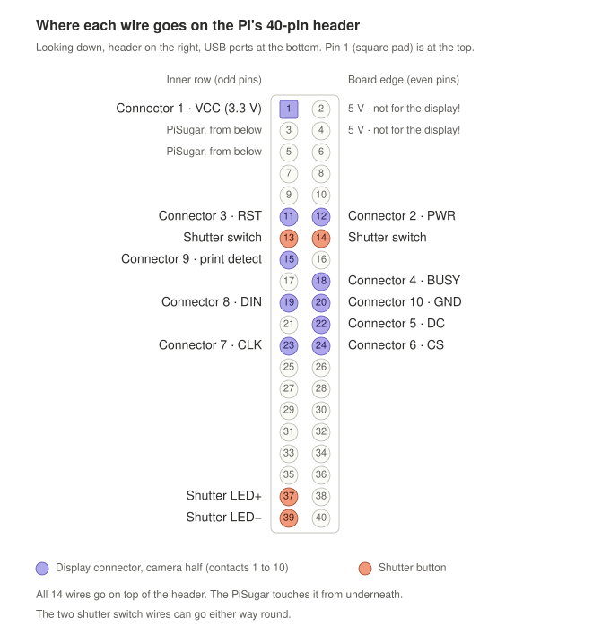

# Inkstant Camera

An instant camera that never runs out of film. Every photo "develops" on a small colour e-paper print that slides out of the back of the camera for you to keep. Each photo is also saved at full size, so you can open them on your phone, with no app and no internet needed.

It's a Raspberry Pi, a camera module, a battery board and a 3.6" six-colour e-paper display, plus one button and one light on the outside.

<!-- Add a photo of the finished camera here. -->

**How it works:**

- **Shoot:** press the shutter. The photo is saved, then develops on the e-paper print in about 15 seconds.
- **Keep:** slide the print out to keep it. E-paper holds its picture with no power, and a magnet on the back lets it go on the fridge. Slide in the same print or a fresh one to keep shooting.
- **No print in?** Photos are still saved. The newest one develops on the next print you slide in.
- **Share:** press a button and the print shows a QR code. Scan it with your phone to see every photo in your phone's browser, and save the ones you want.
- **Slideshow:** while the camera is off, it wakes up every hour to show a different photo on the print in the camera.

## Contents

1. [What you need](#what-you-need)
2. [How it fits together](#how-it-fits-together)
3. [Step 1: Build the hardware](#step-1-build-the-hardware)
4. [Step 2: Prepare the SD card](#step-2-prepare-the-sd-card)
5. [Step 3: Install the software](#step-3-install-the-software)
6. [Step 4: First start](#step-4-first-start)
7. [Using the camera](#using-the-camera)
8. [Getting your photos: the gallery](#getting-your-photos-the-gallery)
9. [Settings](#settings)
10. [Troubleshooting](#troubleshooting)
11. [Commands for SSH](#commands-for-ssh)
12. [For developers](#for-developers)
13. [Project status](#project-status)
14. [Credits](#credits)
15. [License](#license)

## What you need

### Parts

| Part | What to get | Notes |
|---|---|---|
| Computer | Raspberry Pi 3A+ | The smallest option. The Pi 3B, 3B+, 4B and 5 work too. The Pi Zero 2 W isn't supported |
| Camera | [Arducam 12MP IMX708 autofocus camera module](https://www.arducam.com/arducam-12mp-imx708-autofocus-camera-module-with-hdr-pdaf-for-raspberry-pi.html) ([Amazon](https://www.amazon.com/dp/B0C9PYCV9S)) | The 75° lens. Raspberry Pi's own Camera Module 3 (standard lens) uses the same sensor and should work, but only the Arducam has been tested |
| Camera cable | A standard **15-pin to 15-pin** Pi camera cable | Needed for the Pi 3 and 4. The Arducam box may only include a 15-to-22-pin cable, which fits only the Pi 5 |
| Display, one per print | [Waveshare 3.6" e-Paper HAT+ (E)](https://www.amazon.com/dp/B0G656R3M9) | The **HAT+ (E)** with its driver board and 9-pin cable, not the bare panel. Six colours, 600 × 400 |
| Display connector, one pair per print | [JHYOSSTHI magnetic pogo pin connector, 10Pin/E](https://www.amazon.com/dp/B0FF1VJGYS) | Lets the print snap on and slide out. The first pair also gives you the camera's half |
| Battery | [PiSugar 3 Plus](https://docs.pisugar.com/docs/product-wiki/battery/pisugar3/pisugar-3-series) | 5000 mAh battery with a clock, a power button (PWR) and a second button (BTN). It needs firmware 1.2.4 or newer; the setup script checks this for you |
| Shutter button | [uxcell 12 mm momentary push button with an LED ring](https://www.amazon.com/dp/B08HHZCPGN), 3–6 V | Get the **momentary** one, not "latching". The flat-topped version ([B07Z2TDDTZ](https://www.amazon.com/dp/B07Z2TDDTZ)) wires the same. The ring is the camera's only light; a blue ring may look dim ([brighter light](#a-brighter-light)) |
| microSD card | 32 GB or larger, A1-rated, from a known brand | Holds several thousand photos |
| Jumper wires | 14 female-to-female jumper wires | 10 for the display connector, 4 for the button |
| Joining wires | [Solder-seal heat-shrink connectors](https://www.amazon.com/s?k=solder+seal+wire+connectors), or solder and heat-shrink | For joining wires to wires. Nothing is soldered to the Pi or the boards |
| Small parts | Small screws for the connector halves; small neodymium magnets for the back of each print | |
| Charging | A USB-C cable and any 5 V USB charger | |
| Case | 3D-printed | The case design isn't published yet. See [what the case needs](#what-the-case-needs) |

### Which Raspberry Pi?

| Board | Camera cable | Notes |
|---|---|---|
| Pi 3A+ | 15-to-15 pin | The smallest (65 × 56 mm) and uses the least power, so the battery lasts longest |
| Pi 3B, 3B+ | 15-to-15 pin | 85 × 56 mm. The 3B can only join 2.4 GHz Wi-Fi |
| Pi 4B | 15-to-15 pin | 85 × 56 mm. The board Inkstant has been tested on |
| Pi 5 | 15-to-22 pin (usually in the camera's box) | 85 × 56 mm. The PiSugar's spring pins need careful lining up, and the official Active Cooler may not fit with the PiSugar underneath |

The Pi Zero 2 W isn't supported: it needs a different PiSugar and camera cable.

### Tools

- A multimeter with continuity (beep) and diode test
- Wire strippers and flush cutters
- A heat gun for solder-seal connectors, or a soldering iron
- Small screwdrivers
- Masking tape and a pen, for labelling wires
- Optional: a Dupont crimp kit, for the no-solder route
- A computer (Mac, Windows or Linux) on the same Wi-Fi as the camera, to install the software

## How it fits together

```text
                 ┌──────────── CAMERA BODY ─────────────┐
 shutter button ─┤ 4 jumper wires ─┐                     │
 (LED ring)      │                 ▼                     │
                 │   Raspberry Pi (40-pin header)        │
 camera module ──┤──── ribbon cable ──┘  ▲    ▲          │
                 │       10 jumper wires ┘    │ pins underneath
                 │   camera half of the       │ (power and battery data)
                 │   magnetic connector       │
                 │   PiSugar 3 Plus (battery, clock, PWR and BTN buttons, USB-C)
                 └──────────────┬───────────────────────┘
                                │ magnets snap the two halves together
                 ┌──────────────┴───────────────────────┐
                 │ PRINT (slides out to keep)           │
                 │   print half of the connector        │
                 │   ── Waveshare's 9-pin cable ──      │
                 │   Waveshare 3.6" e-Paper HAT+ (E)    │
                 └──────────────────────────────────────┘
```

- The **PiSugar** sits under the Pi. It powers the Pi through spring pins, so there's no cable between them.
- The **camera** plugs into the Pi's camera connector with a ribbon cable.
- The **shutter button** has four wires: two for the switch and two for its light.
- Each **print** is a complete Waveshare display with half of a magnetic connector on its edge. The other half sits in the camera, wired to the Pi. Slide a print in, and the magnets snap the two halves together.
- The display's own plug is a tiny latching connector that isn't made to be unplugged again and again, so it stays plugged in, and the magnetic connector does the sliding in and out.

## Step 1: Build the hardware

Work with everything switched off: the Pi unplugged and the PiSugar off. Touch something metal and grounded, like a radiator or a tap, before you handle the camera board, since static can damage it.

> [!WARNING]
> The display's power wire (VCC) must go to a **3.3 V** pin (pin 1), never a 5 V pin (pins 2 and 4). 5 V can damage the Pi.

### Check the parts

1. The display is the **HAT+ (E)**: a display with a small driver board and a 9-pin cable.
2. You have a **15-to-15-pin camera cable** if you're using a Pi 3 or 4.
3. Charge the PiSugar fully over USB-C, then make sure it's off. If its four little lights are on, hold PWR until they go out.

### Mount the Pi on the PiSugar

1. Peel the protective film off the PiSugar's screw posts.
2. Put the PiSugar under the Pi, with its spring pins under the Pi's 40-pin header and its screw posts under the Pi's mounting holes.
3. Press the Pi down gently onto the spring pins, and fit the screws that came with the PiSugar.
4. **Pi 5 only:** clean any flux off the bottom of the header pins first, and check that every spring pin lands on its pin.

### Connect the camera

1. Find the Pi's connector labelled **CAMERA**. On the Pi 3 and 4 it's between the HDMI port and the audio jack.
2. Gently pull up the connector's plastic flap until it stops.
3. Push the 15-to-15 cable in straight and all the way, with its **metal contacts facing away from the flap**. Push the flap back down.
4. Do the same at the camera board: metal contacts facing away from the flap, towards the board.
5. **Pi 5:** use the 15-to-22-pin cable on either camera connector. The setup script asks which one.

### Wire the shutter button

The button has four metal tabs on the back: two for the switch and two for the light ring.

1. **Find the switch tabs:** set the multimeter to continuity (beep). Two tabs beep only while you hold the button down. Those are the switch.
2. **Find the light's + tab:** set the multimeter to diode test and touch the other two tabs, then swap the probes. The way round that shows a reading (about 2.5 to 3 V for a blue ring) has the **red** probe on LED+. If neither way shows anything, you'll find it at first power-on instead ([Check the light](#check-the-light)).
3. Label the tabs with tape: SW, SW, LED+, LED−.
4. Join a female jumper wire to each tab (solder, then heat-shrink), and keep the wires short.

> [!TIP]
> **No-solder option:** many 12 mm buttons are sold with a plug-in harness that pushes onto the four tabs. It isn't a formal standard, so check it fits your button. Its wire colours vary by seller: find the switch and LED+ wires with the multimeter as above, then join them to jumper wires with solder-seal connectors.

#### A brighter light

A blue ring is dim on the Pi's 3.3 V, and may be hard to see in daylight. Check it before you close the case. If it's too dim, either:

- **Fit the red version of the button** ([flat-topped red: B07Z2THFCL](https://www.amazon.com/dp/B07Z2THFCL)). It's wired the same way.
- **Or power the ring from 5 V through a transistor:** an NPN transistor (2N2222, BC337 or similar) and a 1 kΩ resistor. LED+ goes to 5 V (pin 2 or 4), LED− to the transistor's collector, its emitter to GND (pin 39), and pin 37 through the 1 kΩ resistor to its base. This is the only thing that ever goes on a 5 V pin.

The software works the same either way.

### Build the camera half of the display connector

The connector comes as a pair: a **spring-pin half** (for the camera) and a **flat-pad half** (for a print). Each half has 10 contacts in a row and 10 short coloured wires already attached. The wire colours aren't documented, so you'll map them yourself.

1. **Map the spring half:** with the multimeter on continuity, touch each contact and find which wire it connects to. Number the contacts 1 to 10 from one end, mark contact 1 with a dot of paint or tape, and write down which colour goes to which number.
2. **Join each of the 10 wires to a female jumper wire** (solder-seal connectors and a heat gun make this one step), and label each jumper with its contact number.
3. Screw the spring half in at the end of the case's slot, facing where the print comes in. On the bench, a clamp will do.

### Build a print (display module)

Do this once for each print you want.

1. **Map the flat-pad half** the same way, and mark its contact 1. Snap the two halves together and check with the multimeter that contact 1 meets contact 1. One face is the mirror of the other, so map each half on its own.
2. **Map the display's cable:** the cable has a white plug on one end and nine wires on the other. With the white plug out of the board, check each wire against the plug's contacts. The plug's pin order is: 1 VCC, 2 GND, 3 DIN, 4 CLK, 5 CS, 6 DC, 7 RST, 8 BUSY, 9 PWR.
3. **Cut** the display cable and the pad half's wires short enough to fit the print's case. The whole run from the Pi to the display should stay under about 20 cm.
4. **Join each display wire to a pad-half wire** following the [connector pinout](#display-connector-pinout): VCC to 1, PWR to 2, RST to 3, BUSY to 4, DC to 5, CS to 6, CLK to 7, DIN to 8.
5. **Join three wires together:** the display's GND, pad wire 9 and pad wire 10. Joining 9 to GND is how the camera knows a print is in.
6. Insulate every join.
7. Plug the white plug into the display board's 9-pin socket. It stays there for good.
8. Screw the flat-pad half to the print's leading edge, facing out, and fit the magnets on the back.

> [!TIP]
> **No-solder option:** crimp male Dupont pins onto the pad half's wires and plug them straight into the display cable's female plugs, so the cable isn't even cut. Crimp wires 9 and 10 into the same pin for GND. Tape over the plugged joints so they can't wiggle apart.

### Plug the wires onto the Pi

All 14 wires go on top of the Pi's 40-pin header. The PiSugar touches the header from underneath, so they don't get in each other's way.

**Finding pin 1:** it's at the end of the header farthest from the USB ports, and it has a square solder pad on the underside of the board. Odd-numbered pins are on the row nearer the middle of the board; even-numbered pins are on the row along the board's edge.

| Wire | Pi pin |
|---|---|
| Connector 1 (VCC) | **1** (3.3 V) |
| Connector 2 (PWR) | 12 |
| Connector 3 (RST) | 11 |
| Connector 4 (BUSY) | 18 |
| Connector 5 (DC) | 22 |
| Connector 6 (CS) | 24 |
| Connector 7 (CLK) | 23 |
| Connector 8 (DIN) | 19 |
| Connector 9 (print detect) | 15 |
| Connector 10 (GND) | 20 |
| Shutter switch (both SW wires) | 13 and 14, either way round |
| Shutter LED+ | 37 |
| Shutter LED− | 39 |

The same thing as a picture. Look down on the Pi and turn it so the header runs down the right-hand side, with the USB ports at the bottom; pin 1 is then at the top:



These pins are the same on every supported Pi.

#### Display connector pinout

| Contact | Signal | Camera half goes to Pi pin | Print half goes to display wire |
|---|---|---|---|
| 1 | VCC (3.3 V) | 1 | 1 VCC |
| 2 | PWR | 12 | 9 PWR |
| 3 | RST | 11 | 7 RST |
| 4 | BUSY | 18 | 8 BUSY |
| 5 | DC | 22 | 6 DC |
| 6 | CS | 24 | 5 CS |
| 7 | CLK | 23 | 4 CLK |
| 8 | DIN | 19 | 3 DIN |
| 9 | Print detect | 15 | joined to GND (with contact 10) |
| 10 | GND | 20 | 2 GND |

VCC and GND are at opposite ends, so a connector that's off by one contact can never short them.

<details>
<summary><b>Testing before the magnetic connector is built</b></summary>

You can try the display without the connector by plugging the display cable's nine wires straight onto the Pi: VCC to pin 1, GND to 20, DIN to 19, CLK to 23, CS to 24, DC to 22, RST to 11, BUSY to 18 and PWR to 12.

Then add one more jumper wire from **pin 15 to a ground pin** (pin 9 or 25). That's the job the print's GND join does in the finished camera: without it, the camera thinks no print is in and never updates the screen.

</details>

### Check before powering on

With everything still off:

1. **No short:** on the camera half of the connector, the resistance between contact 1 (VCC) and contact 10 (GND) isn't close to zero, with and without a print snapped on.
2. **VCC is on pin 1, not pin 2 or 4.** Check it twice.
3. **Every signal reaches the print:** with a print snapped on, check continuity from each Pi pin in the table to the matching wire in the print.
4. **Print detect:** with a print snapped on, pin 15 beeps to pin 20. With it off, it doesn't.
5. **Shutter:** pins 13 and 14 beep only while the button is pressed.

### What the case needs

The case design isn't published yet. If you design your own, it needs:

- A slot at the back for the print, shaped so it only goes in one way round: the magnets may not stop a print going in backwards. The camera's half of the connector screws in at the end of the slot, facing the incoming print.
- A shaded or recessed window for the display: long direct sunlight can permanently damage e-paper.
- A 12 mm hole for the shutter button, with room behind it for the button's 23 mm length and its wires.
- Openings or printed caps for the PiSugar's PWR and BTN buttons, its USB-C port and its four battery lights, which are all on one edge.
- Air around the PiSugar's charging chip, which gets hot (50 to 80 °C) while charging.
- A window for the camera, and a way to hold the camera board square. If the camera or display ends up upside down, the setup script can flip the picture.
- A way to reach the microSD card.
- The Pi 3A+ is 65 × 56 mm; the other boards are 85 × 56 mm with ports in different places.
- For each print: the display board (89.5 × 59 mm), the flat-pad half on its leading edge, and pockets for the magnets.

## Step 2: Prepare the SD card

You'll use **Raspberry Pi Imager**, a free app from Raspberry Pi, to put the operating system on the microSD card and set it up to join your Wi-Fi.

1. Download and install Imager from [raspberrypi.com/software](https://www.raspberrypi.com/software/), and put the microSD card in your computer.
2. In Imager, choose:
   - **Device:** your Raspberry Pi model.
   - **Operating system:** Raspberry Pi OS (other) → **Raspberry Pi OS Lite (64-bit)**.
   - **Storage:** your microSD card.
3. When Imager offers to **customise** the settings, fill in:
   - **Hostname:** `inkstant` (the examples below assume this name; if you pick another, use it instead).
   - **Username and password:** anything you like. You'll need them in a minute.
   - **Wi-Fi:** your home Wi-Fi's name and password, and your country.
   - **Time zone** and keyboard layout.
   - **SSH:** turn it on, with password login. SSH lets you type commands on the Pi from your computer.
4. Write the card. Imager erases it first.

## Step 3: Install the software

1. Put the microSD card in the Pi, and a print in the camera if you've built one.
2. **Turn the camera on:** press PWR briefly, then press and hold it. The PiSugar's lights count up from 1 to 4 and the Pi starts.
3. **Wait about two minutes.** The first start takes a while because the Pi sets itself up. The shutter's light stays off until the software is installed; that's normal.
4. **Connect to the Pi from your computer.** Open **Terminal** on a Mac or Linux, or **PowerShell** on Windows, and type (with your username):

   ```bash
   ssh your-username@inkstant.local
   ```

   - The first time, it asks "Are you sure you want to continue connecting?". Type `yes` and press Enter.
   - Type your password. Nothing appears on screen while you type; that's normal. Press Enter.
   - If `inkstant.local` isn't found, wait another minute and try again. Your router's app or web page can also show the Pi's IP address, which works instead (`ssh your-username@192.168.1.23`, for example).
5. **Run the setup command.** Copy this line, paste it into the same window, and press Enter:

   ```bash
   curl -fsSL https://raw.githubusercontent.com/EnriqueNeyra/inkstant-camera/main/setup.sh | sudo bash -s -- --dev
   ```

   It may ask for your password again. Then it downloads Inkstant, checks it, and installs it.

   `--dev` turns on **developer mode**, which keeps the camera on your home Wi-Fi so you can SSH back in if something needs fixing. It's a good idea for your first build. It uses a little more battery, and you can turn it off later in the gallery (Settings → Advanced). To install without it, use `| sudo bash` at the end instead of `| sudo bash -s -- --dev`.

6. **Answer the questions.** Press Enter to accept the suggestion in brackets:

   | Question | What to answer |
   |---|---|
   | Camera Wi-Fi name | The name of the Wi-Fi network the camera makes when you're away from home. Enter keeps the suggested `Inkstant-XXXX` |
   | Camera Wi-Fi password | Enter keeps the random one it suggests. It's shown again at the end |
   | Use "(your Wi-Fi)" for sharing at home? | Yes. Then at home your phone sees the photos over your own Wi-Fi |
   | Wi-Fi country | Only asked if it isn't set yet: two letters, like `US` or `GB` |
   | Is the camera mounted upside down? | No, unless your case holds it upside down |
   | Is the display module mounted upside down? | No, unless your case holds it upside down |
   | Which camera connector (Pi 5 only) | 0 or 1, as printed next to the connector you used |

7. **Wait** about 15 to 25 minutes. It shows each step as it goes. If anything goes wrong, it stops and says what to fix. Running the same command again is always safe.
8. **Write down the camera's Wi-Fi name and password** from the summary at the end. You'll need them to see your photos away from home. (You can also find them later in the gallery: Settings → Camera Wi-Fi.)
9. Press Enter to restart.

## Step 4: First start

1. **Watch the light:** it blinks slowly while the camera starts (up to about half a minute), then stays solid. Solid means ready.
2. **Take a photo:** with a print in, press the shutter. The light winks, then blinks slowly while the photo develops on the print, which takes about 15 seconds.
3. **Open the gallery:** hold BTN on the PiSugar for 2 seconds. The print shows a QR code; scan it with your phone's camera ([more below](#getting-your-photos-the-gallery)).
4. **Run the setup check:** in the gallery, tap the **Settings** button (the sliders icon, top right), open **Advanced**, and look at **Setup check**. Every row should have a tick. If one doesn't, it says how to fix it.

### Check the light

If the shutter's light ring never lights, its two LED wires are probably swapped. Swap the wires on pins 37 and 39.

<details>
<summary>Testing the light before running the setup script</summary>

Over SSH, before the setup script, `pinctrl set 26 op dh` turns the ring on and `pinctrl set 26 op dl` turns it off. If it doesn't light, swap the wires on pins 37 and 39. After setup, the camera controls the light itself.

</details>

### Before you close the case

- [ ] The light ring is bright enough indoors and in daylight. If not, see [a brighter light](#a-brighter-light).
- [ ] A print snaps on firmly every time, and the magnets hold it.
- [ ] With the print out, **Show on camera** in the gallery says there's no display module; slide it back in and it works.
- [ ] Swapping prints while the camera is on doesn't restart anything.
- [ ] PWR and BTN press reliably through the case.
- [ ] While charging, the PiSugar doesn't get too hot inside the case.
- [ ] The screen is easy to read outdoors in the shade.

## Using the camera

### Buttons

| Button | Press | What happens |
|---|---|---|
| **Shutter** (the button with the light ring) | Press | Take a photo. If the camera is asleep, it wakes and takes the photo a second or two later |
| **PWR** (on the PiSugar's edge) | Short press, then press and hold | Turn on |
| | Long press while on | Turn off. A photo that's developing finishes first |
| **BTN** (on the PiSugar's edge) | Hold for 2 seconds | Sharing on or off: the print shows a QR code for the gallery |
| | Double tap while sharing | Switch between home Wi-Fi and the camera's own Wi-Fi (for a guest's phone) |

- **A quick tap on BTN does nothing,** so a bump in a bag can't start sharing.

- **While a photo develops** (about 15 to 20 seconds), the shutter and BTN are ignored. They work again as soon as the photo is showing.
- **While sharing,** the shutter is off, so a photo can't be taken by accident while you show the print to someone. The light blinks slowly, and the print says how to stop. Hold BTN to stop sharing, and the shutter works again once the print shows your photo.
- Plugging in to charge doesn't turn the camera on.

### The status light

The ring around the shutter is the camera's only light, and it has just four looks:

| Light | Meaning |
|---|---|
| Solid | On: press the shutter to take a photo |
| Slow blink (on half a second, off half a second) | Wait, the shutter won't take a photo: starting up, developing a photo, sharing, or finishing before it turns off |
| A short wink (off for a moment) | Your photo was taken |
| Off | The camera is off. It also stays off while the slideshow changes the picture |

- **No wink when you press the shutter?** No photo was taken. Start sharing, and the gallery says why at the top of the page.
- **Everything else shows elsewhere:** sharing shows its QR code on the print, and the battery level and any problems show in the gallery. The PiSugar's own four lights show the charge when you press PWR.

The gallery has the same list under Settings → Light → What it means.

### Prints

- **Keep a photo:** slide the print out. It keeps its picture with no power.
- **The newest photo is the one waiting to develop.** If you take five photos with no print in, then slide one in, only the fifth develops. The others are all saved and in the gallery.
- **A print you slide in keeps whatever it shows,** unless a photo is waiting to develop. A kept photo is never overwritten by accident.
- **Pulling a print out while it's developing** stops it, like pulling an instant photo out early. That photo develops on the next print instead.
- **To put any photo on the print in the camera,** open it in the gallery and tap **Show on camera**.
- **Swapping is safe** while the camera is on.
- **Look after the prints** (Waveshare's advice):
  - Keep them out of long direct sunlight, which can damage the screen for good.
  - Use them between 0 and 40 °C. Cold can give the colours a tint.
  - A picture left on a print for many months can burn in. To store a print, give it a white screen first: put it in the camera with the slideshow off, then turn the camera off, and the screen turns white. Waveshare suggests storing them for at most 6 months.
  - Each print is rated for about a million picture changes.

### Sleep, turning off and the battery

- **Sleep:** after 5 minutes without taking photos, the camera rests its image sensor to save battery. The light stays solid: press the shutter as usual, and the photo is taken a second or two later.
- **Turning off:** after 10 minutes without use, the camera turns itself off. Before it does, it sets an alarm for the next slideshow picture.
- **Battery saver** turns on by itself at 20%: the camera sleeps and turns off sooner.
- **Low battery:** the gallery warns at 15%, and the camera turns itself off at 5%.
- **Charging:** plug a USB-C charger into the PiSugar. Charging doesn't turn the camera on. The PiSugar's four small lights show the charge level.
- **The PiSugar gets hot while charging:** its charging chip reaches 50 to 80 °C. Don't touch it, and leave air around it in the case.
- **The battery keeps the camera's clock.** If the battery runs completely flat or is unplugged, the clock resets: share at home to set it from the internet, or use "Use this phone's time" in Settings.
- The PiSugar's small round button is a reset, for emergencies only.

### Slideshow

While the camera is off, it wakes up every hour to put a different photo on the print in the camera, then turns off again. You can change how often, the order, and set quiet hours (for example, no changes overnight) in the gallery's settings.

If the camera won't wake itself again (the slideshow is off, the battery is low, or the clock isn't set), it turns the screen white as it turns off, to protect the display. **Take the print out first if you want to keep its photo.**

## Getting your photos: the gallery

The gallery is a small website that the camera runs while sharing is on. It works in any phone or computer browser: there's no app to install, no account and no internet needed.

### At home

1. **Hold BTN** on the PiSugar for 2 seconds. The camera looks for your home Wi-Fi for a few seconds.
2. **The print shows a QR code.** Scan it with your phone's camera, and the gallery opens in your browser.
3. **Without the QR code** (no print in, or on a laptop), open a browser on any device on the same Wi-Fi and go to the address printed next to the QR code (like `http://192.168.1.23`), or to **`http://inkstant.local`** (your hostname, followed by `.local`).

### Away from home

When the camera can't find your home Wi-Fi, it makes its own Wi-Fi network instead. To use it even at home, for a guest whose phone isn't on your Wi-Fi, **double-tap BTN** while the home QR code is showing. Double-tap again to go back to home Wi-Fi.

1. The print shows **two QR codes**, with the network's name and password underneath.
2. Scan the first QR code ("1. Join Wi-Fi") to join the camera's Wi-Fi. (Or join it by hand in your phone's Wi-Fi settings, with the name and password from the end of setup.)
3. Scan the second QR code ("2. Open photos"), or go to **`http://10.42.0.1`**.

Your phone may say this Wi-Fi has no internet. That's expected: stay connected.

### In the gallery

- **See a photo:** tap it.
- **Save one photo to your phone:** open it, then press and hold the photo and choose "Save to Photos" (iPhone) or "Download image" (Android).
- **Save many:** tap **Select**, choose photos or whole days, then **Download**. They come as one ZIP file. **Download all…** in the ⋯ menu gets every photo.
- **Delete:** tap **Select**, choose photos, then **Delete**.
- **Show on camera:** puts the photo you're looking at on the print in the camera.
- **See the print:** while looking at a photo, switch from **Photo** to **Print** at the top to see it as the camera's display shows it, in the display's six colours. Save or download it the same way as a photo. The gallery keeps one tile per photo; the print is stored with it.
- **Settings:** the sliders icon at the top right.

### Stop sharing

Hold BTN again for 2 seconds, tap **Stop sharing** in the gallery, or just leave it: on battery, sharing stops by itself after 10 minutes without anyone using the gallery. The print goes back to showing your photo, and the shutter works again once it has.

> [!NOTE]
> The gallery has no login. At home, anyone on your Wi-Fi can open it while sharing is on, including deleting photos. Sharing only runs when you turn it on, and stops by itself.

## Settings

In the gallery, tap the sliders icon at the top right.

| Setting | Default | What it does |
|---|---|---|
| Slideshow | On | Change the picture on the print while the camera is off |
| Change picture every | 1 hour | From 5 minutes to 24 hours |
| Order | Shuffle | Or newest first |
| Quiet hours | Off | No slideshow changes between two times, such as overnight |
| Sleep after | 5 min | Rest the image sensor when you aren't shooting |
| Turn off after | 10 min | Turn off when nobody is using the camera |
| Battery saver | Off | Sleep and turn off sooner. "Turn on at 20%" switches it on by itself |
| Stop sharing after | 10 min | On battery only |
| Turn off at | 5% | The low-battery level for turning off |
| Limit charging to about 80% | Off | Longer battery life over the years; each charge lasts a bit less |
| Home networks | Your Wi-Fi from setup | Up to five networks the camera uses for sharing at home |
| Camera Wi-Fi | Set during setup | The camera's own Wi-Fi name and password. **Show** reveals the password |
| Date & time | From the battery's clock | "Use this phone's time" sets the clock and time zone from your phone |
| Software | | Your version, and **Check for updates** (when sharing at home) |
| Advanced → Developer mode | Off, or on with `--dev` | Keeps the camera on your home Wi-Fi so SSH works, and stops it turning off while charging |
| Advanced → Setup check | | Checks every part of the camera, with a hint for anything that fails |
| Advanced → Logs | | Downloads the camera's logs, for reporting a problem |

## Troubleshooting

| Problem | What to try |
|---|---|
| `ssh: Could not resolve hostname inkstant.local` | Wait a minute after turning on and try again. Check the hostname you set in Imager. Or use the Pi's IP address from your router |
| `WARNING: REMOTE HOST IDENTIFICATION HAS CHANGED` after re-flashing the card | Expected after a fresh install. Run `ssh-keygen -R inkstant.local`, then connect again |
| Setup stops: "No internet" | Check the Pi joined your Wi-Fi (the name and password in Imager), wait a minute for its clock to set, then run the command again |
| Setup stops: "No PiSugar on I2C" | The PiSugar isn't seated or is switched off. Turn everything off, check the Pi sits flat on the spring pins, press PWR, and run the command again |
| Setup says "PiSugar firmware is too old" | The board needs firmware 1.2.4 or newer. Contact PiSugar support |
| Setup warns "No camera found" | Turn off, then reseat the ribbon at both ends with the metal contacts facing away from the flaps. On a Pi 3 or 4, the cable must be 15-pin at both ends |
| Can't SSH in after setup | Expected without developer mode: the camera turns its Wi-Fi off to save battery. SSH works again while sharing at home, or turn on Settings → Advanced → Developer mode |
| A monitor shows nothing | Expected: setup turns HDMI off to save power. Use SSH |
| The light doesn't wink when you press the shutter | No photo was taken. Start sharing, and the gallery shows what's wrong at the top of the page |
| The print never updates | Open a photo in the gallery: if **Show on camera** says "No display module in the camera" with a print in, the print-detect wiring isn't reaching pin 15. Check the print's GND, 9 and 10 join, and connector contact 9 to pin 15 |
| The light never lights | The LED wires on pins 37 and 39 are probably swapped. A blue ring is also quite dim at 3.3 V |
| The gallery won't open from the QR code | Check your phone is on the same Wi-Fi (at home) or joined the camera's Wi-Fi (away). Some guest and office networks block devices from reaching each other: double-tap BTN while sharing to switch to the camera's Wi-Fi |
| The browser says the site can't be reached, though the phone is on the right Wi-Fi | Some browsers, like Chrome on iPhone, insist on a secure (`https`) connection, which the gallery doesn't use. Open the address in Safari, or turn off the browser's "Always use secure connections" setting |
| `inkstant.local` doesn't open on some phones | Some Android phones don't support `.local` names. Use the number address printed next to the QR code |

**More help:** the gallery's Settings → Advanced → Setup check names the problem and the fix. Over SSH, `sudo inkstant-ctl selftest` runs the same check, `sudo journalctl -u inkstant` shows the camera's log, and the installer's log is in `/var/log/inkstant-install.log`.

## Commands for SSH

These work over SSH once the software is installed (with developer mode on, or while sharing at home).

| Command | What it does |
|---|---|
| `sudo inkstant-ctl status` | Everything the camera knows: battery, camera, print, sharing, storage |
| `sudo inkstant-ctl selftest` | Run the setup check |
| `sudo inkstant-ctl share on` | Start sharing, and print the gallery's address (`--hotspot` uses the camera's own Wi-Fi) |
| `sudo inkstant-ctl share off` | Stop sharing |
| `sudo inkstant-ctl dev on` / `off` | Developer mode on or off |
| `sudo inkstant-ctl shutdown` | Turn off cleanly (`--reboot` to restart) |
| `sudo inkstant-ctl rollback` | Go back to the previous installed version |
| `sudo journalctl -u inkstant -f` | Watch the camera's log live (Ctrl+C to stop) |

**Reinstall or repair:** run the setup command from [Step 3](#step-3-install-the-software) again. It keeps your photos and settings.

**Change your setup answers** (like the camera's orientation):

```bash
sudo /opt/inkstant/current/install/install.sh --reconfigure
```

**Uninstall** (keeps your photos; add `--purge` to delete them too):

```bash
sudo /opt/inkstant/current/install/uninstall.sh
```

<details>
<summary><b>More setup options</b></summary>

Options go at the end of the setup command, after `bash -s --`. For example: `curl -fsSL https://raw.githubusercontent.com/EnriqueNeyra/inkstant-camera/main/setup.sh | sudo bash -s -- --dev --yes`.

| Option | What it does |
|---|---|
| `--dev` | Developer mode: home Wi-Fi and SSH stay on |
| `--yes` | Accept every default, and restart at the end without asking |
| `--no-reboot` | Finish without restarting |
| `--check` | Run the checks and change nothing |
| `--ref <branch or tag>` | Install that branch or tag instead of the latest release |
| `--hotspot-ssid NAME`, `--hotspot-password PW` | The camera's Wi-Fi name and password |
| `--home-ssid NAME`, `--home-password PW`, `--no-home` | The home network for sharing |
| `--country CC` | The Wi-Fi country |
| `--camera-rotate 0\|180`, `--display-rotation 0\|180` | Mounted upside down |
| `--camera-port cam0\|cam1` | Pi 5: which camera connector |
| `--force-model` | Try anyway on a board that isn't supported |

From a copy of this repository on the Pi, `sudo ./setup.sh` installs that copy.

</details>

## For developers

The design notes: [SPEC.md](SPEC.md) is the full design record, with how the software behaves, every decision and the sources behind it. [HARDWARE.md](HARDWARE.md) has every part's measurements, for designing the case.

<details>
<summary><b>How the software is organised</b></summary>

- **Camera app** (`src/inkstant/camera_app`): runs as `inkstant.service`. It owns the camera (Picamera2), the e-paper driver, the status light, sleep and the battery saver, the slideshow and share mode.
- **Gallery** (`src/inkstant/gallery`): a small Flask web app, served by Waitress on port 80 as the unprivileged user `inkstant-web`. It only runs while sharing, and asks the camera app to make every change through a Unix socket.
- **Hardware layer** (`src/inkstant/hw`): GPIO, the e-paper driver, the camera, the PiSugar, Wi-Fi through NetworkManager, and fakes of each for the tests and the simulator.
- **Installer** (`setup.sh`, `install/`): `setup.sh` downloads the latest release (or, before the first release, the code on `main`) and runs `install/install.sh`. That installs packages and pisugar-server; `install/configure.py` writes every file, and is safe to run again.
- **Tools** (`tools/`): a desktop simulator, bench tests for the real hardware, the palette tuner and the release builder.

On the Pi, the code runs from `/opt/inkstant/current` with Raspberry Pi OS's own Python packages; photos and settings live in `/var/lib/inkstant`.

</details>

<details>
<summary><b>Run the tests and the simulator</b></summary>

With [uv](https://docs.astral.sh/uv/) and Python 3.13:

```bash
uv venv --python 3.13 .venv && uv pip install --python .venv -r requirements-dev.txt
```
```bash
.venv/bin/python -m pytest
```
```bash
.venv/bin/python tools/sim.py --port 8080
```

The simulator runs the real camera app with fake hardware. Type `s` and Enter for the shutter, `h` to hold BTN (sharing on or off), `d` for a BTN double tap, `m` to slide a print in or out, and `q` to quit. Open `http://localhost:8080` for the gallery; the print's picture is written to `sim/display.png`.

</details>

<details>
<summary><b>Bench tests on the real hardware</b></summary>

`tools/bench/` has one script per hardware test. Stop the camera app first, run a script with `sudo python3`, and start the app again afterwards:

```bash
sudo systemctl stop inkstant
```
```bash
sudo python3 /opt/inkstant/current/tools/bench/camera_fullres.py
```
```bash
sudo systemctl start inkstant
```

| Script | Checks |
|---|---|
| `camera_fullres.py` | Full-resolution capture, camera memory, JPEG and screen-image times, sleep and wake |
| `shutter_latency.py` | Shutter delay at several frame rates (`--auto` without a button) |
| `settle.py` | Focus, exposure and colour settling |
| `epd_show.py` | The display: test chart, step timings, no print, pulling it out mid-update |
| `inputs.py` | Shutter, print detect and BUSY; `--light` steps through every light pattern |
| `pisugar_probe.py` | PiSugar socket, settings, firmware, clock, alarm, BTN taps, watchdog |
| `poweroff_test.sh`, `wake_cycle.sh`, `boot_timing.sh` | Power cut after shutdown, slideshow wake, boot-to-ready time |
| `share_e2e.md` | A checklist for sharing with an iPhone and an Android phone |

Results are saved in `/var/lib/inkstant/bench`. `tools/palette_tuner.py` tunes the dithering colours on the real panel.

</details>

<details>
<summary><b>Publishing a release</b></summary>

Bump `VERSION`, then push a tag `v<VERSION>` (for example `v1.0.1`). CI runs the tests, builds `inkstant.tar.gz` and `SHA256SUMS` with `tools/build_release.py`, and attaches them to a GitHub release. From then on, the setup command installs the latest release, and cameras find it under Settings → Software → Check for updates.

</details>

## Project status

The software is complete, with automated tests against simulated hardware. On a real Raspberry Pi 4, it's been tested taking photos, developing them on the display (with colours measured on the panel), the gallery, sharing over home Wi-Fi and over the camera's own Wi-Fi, the slideshow waking the camera, and BTN. Still to test on the real hardware: the PWR button, plugging in the charger, and sliding a print in and out. The case design and the first published release are still to come.

## Credits

- The e-paper driver (`src/inkstant/hw/epd.py`) follows Waveshare's [epd3in6e driver](https://github.com/waveshareteam/e-Paper); their permission notice is in that file.
- The battery board runs PiSugar's [pisugar-server](https://github.com/PiSugar/pisugar-power-manager-rs), which the setup script downloads from PiSugar's releases.
- Inspired by other e-paper cameras: Strange Inventions' [*I Invented Digital Film*](https://www.youtube.com/watch?v=9giyTIqTx1w), Cameron Dowd's [ESP32 e-paper Polaroid](https://liliputing.com/this-diy-e-paper-instant-camera-is-like-a-digital-polaroid-for-ephemeral-photos/), and befinitiv's [*Digital Film Cartridge for Analog Cameras*](https://www.youtube.com/watch?v=5DdQN0NVVT0).

## License

Inkstant is free to build, use, change and share for **noncommercial** purposes, under the [PolyForm Noncommercial License 1.0.0](LICENSE).

- **You can:** build one for yourself or as a gift, or with a school, club or charity; change the code; and share your changes, as long as you pass on the license and its copyright notice.
- **You can't:** sell cameras, kits or the software, or use it in a commercial product or service, without permission. Ask through a GitHub issue if you'd like to.

Because it limits commercial use, this is "source-available" rather than "open source" in the strict sense of the [Open Source Definition](https://opensource.org/osd), which allows any use.

`src/inkstant/hw/epd.py` contains code from Waveshare's e-paper driver, which keeps Waveshare's own permission notice (in that file).
